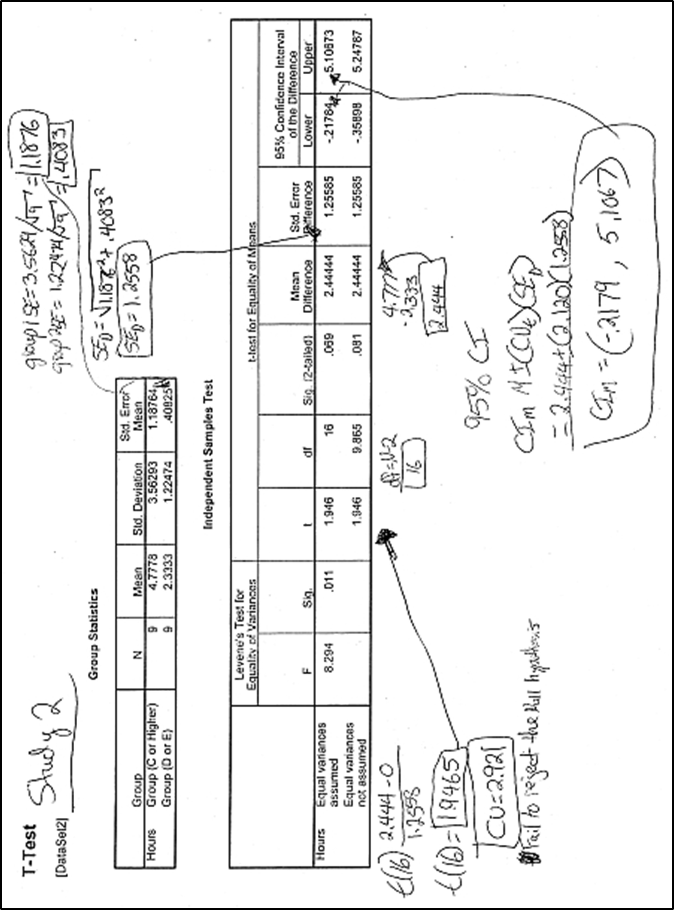

# [`Craig A. Wendorf`](../README.md)

## Grading Examples of Statistics Problems

This document provides a graded example of a Statistics homework problem. Here, you need to demonstrate your ability reasonably implement the relevant procedure and to communicate a correct answer. And because I always ask for a short, written interpretation of the solution, there is an expected of proper written form as well (i.e., proper grammar, APA style for Results, etc.).

### Satisfactory Answer

#### Prompt and Response

An instructor hypothesized that students who earn a B or higher spend a significantly different number of hours per week outside of class on coursework than students who receive a C or lower. She collected two independent samples:

- B or higher: 9, 4, 7, 11, 1, 5, 3, 2, 1
- C or lower: 3, 2, 0, 3, 2, 1, 4, 3, 3

Given the data for the study above, use SPSS to obtain an independent samples t test and a confidence interval for the difference between the means (using α = .01).

- On your SPSS output, calculate “by hand” the statistical significance test and the confidence interval using the descriptive statistic information given to you. [You do not need to recalculate the means and standard deviations.] Use appropriate marks (e.g., arrows, circles, etc.) to show that your calculations match the statistics provided by SPSS. (3 pts.)  
- Describe your findings in an appropriate APA-style Results section. Be sure to follow the standards given in class. (1 pt.)

#### Grading and Feedback

| Category | Unacceptable | Problematic | Satisfactory | Commendable |
| :- | - | - | - | - |
| Procedure & Solution (0-3 Points) | &#9744; Inappropriate  &#9744; Incorrect  &#9744; Incomplete | &#9744; Vague Relevance  &#9744; Major Inaccuracies  &#9744; Insufficient Detail | &#9744; Implied Relevance  &#9744; Minor Inaccuracies  &#9744; Broad Detail | **&#9745; Explicit Relevance  &#9745; No Inaccuracies  &#9745; Thorough Detail** |

| Category | Unacceptable | Acceptable |
| :- | - | - |
| Quality of Writing (0-1 Point) | **&#9745; Inadequate Format**  &#9744; Major Errors  &#9744; Poor Consistency | &#9744; Adequate Format  &#9744; Few or No Errors  &#9744; Adequate Consistency |

- This student did a very good job with the calculation part of the problem. The SPSS is printout is correct. The hand calculations are on the printout and they match the SPSS printout. The student clearly indicated that she understood how the calculations match the output by using arrows and boxes.
- However, the second part of the problem is virtually missing. There is a slight interpretation of the output (“fail to reject the null hypothesis”), but there is no written description or explanation of the results in appropriate APA style.
